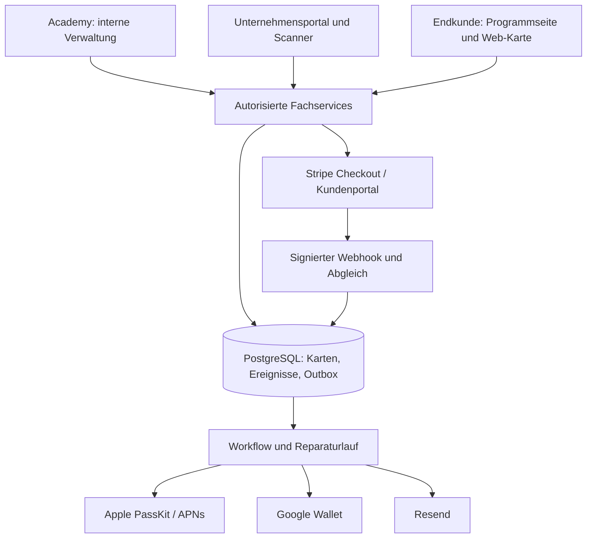

# Pflichtenheft: Wallet-Stempelkarten-SaaS

| Dokumentmerkmal | Wert |
| --- | --- |
| Projekt | Stempelkarten als SaaS-Modul der Academy Fi |
| Version | 1.0 |
| Datum | 22.10.2026 |
| Status | Technische Umsetzungsspezifikation; keine Bestätigung einer bereits erfolgten Implementierung |
| Fachliche Grundlage | [Lastenheft Version 1.0](LASTENHEFT_STEMPELKARTEN.md) |
| Zielplattform | Bestehende Academy-Fi-Anwendung mit eigenständigem Geschäftskundenbereich |

## 1. Zweck und Geltungsbereich

Dieses Pflichtenheft legt fest, wie die Muss-Anforderungen des Lastenhefts technisch umgesetzt, geprüft und in Betrieb genommen werden. Fachliche Entscheidungen des Lastenhefts haben Vorrang. Technische Festlegungen dieses Dokuments konkretisieren die Umsetzung, ohne den vereinbarten Funktionsumfang zu reduzieren.

Geliefert wird das vollständige Release mit beiden Wallets, beiden Scanverfahren, dynamischen Geschäfts-QR-Codes, Mitarbeiterbestätigung, Gratisbelohnungen, Wiederherstellung, drei Tarifen, internationaler EUR-/USD-Abrechnung und interner Betriebsverwaltung. Die Entwicklung erfolgt in Teilpaketen; ein Zwischenstand ist nicht mit der vollständigen Produktabnahme gleichzusetzen.

Nicht geliefert werden die im Lastenheft ausgeschlossenen Funktionen, insbesondere Filialverwaltung, Kassenschnittstellen, unbeaufsichtigte Stempelvergabe, mehrere offene Belohnungen, Marketing-Push und native Apps. Ein Fertigstellungstermin und ein Verfügbarkeits-SLA werden durch dieses Dokument nicht zugesagt.

## 2. Technischer Ausgangszustand und Zielarchitektur

### 2.1 Vorhandene Grundlage

Im Repository sind Next.js 16 mit App Router, React, TypeScript, Tailwind CSS, shadcn-Komponenten, Prisma mit Neon/PostgreSQL, Better Auth, next-intl, Resend, UploadThing und Workflow bereits vorhanden. Die bestehenden globalen Benutzerrollen sind `OWNER` und `INTERN`. Öffentliche Registrierung ist derzeit deaktiviert. Viele vorhandene Zugriffe verlangen eine Sitzung, aber keine ausdrückliche Zugehörigkeit zur internen Academy.

Die Erweiterung nutzt diese Grundlage. Es werden weder eine zweite Benutzerdatenbank noch getrennte Microservices eingeführt. Die vorhandenen Academy-Datensätze erhalten keine künstliche Kunden-Mandantenzuordnung.

### 2.2 Bausteine und Verantwortlichkeiten

| Baustein | Verantwortung |
| --- | --- |
| Identität und Zugriff | Geschäftskonten, E-Mail-Verifikation, Academy-Abgrenzung, Unternehmensmitgliedschaften und Einladungen. |
| Programmverwaltung | Karteneditor, Branding-Dateien, Veröffentlichung, Archivierung und unveränderliche Sammelbedingungen. |
| Loyalty-Service | Kartenausgabe, Stempel, Sammelzyklen, Korrekturen und Belohnungseinlösung. |
| Scan-Service | Stationen, dynamische Challenges, Kundenanfragen, Vergleichscodes und Mitarbeiterfreigabe. |
| Wallet-Service | Anbieterneutrale Aufträge, Apple-Pass-Erzeugung, Google-Objekte und Synchronisationszustände. |
| Recovery-Service | Freiwillige E-Mail-Verknüpfung, Verifikation, Wiederherstellung und Widerruf. |
| Billing und Berechtigungsumfang | Stripe-Zuordnung, wirksamer Tarif, Preisvarianten und transaktionale Limitprüfung. |
| Betrieb und Auswertung | Outbox-Verarbeitung, Reparaturläufe, Audit-Protokoll, Statistiken und interne Verwaltung. |

Serverlogik wird in `src/lib/loyalty` nach diesen Verantwortlichkeiten gegliedert. UI-Komponenten stehen getrennt von Fachlogik; langlebige Jobs verwenden die vorhandene Workflow-Infrastruktur. Seiten, Server Actions, HTTP-Endpunkte und Hintergrundjobs rufen dieselben Fachservices auf. Wallet- und Stripe-Aufrufe finden ausschließlich serverseitig statt.

Ergänzt werden Eingabevalidierung mit Zod, QR-Erzeugung mit `qrcode`, ein clientseitig geladenes Kameramodul auf Basis von `html5-qrcode`, Apple-Pass-Erzeugung mit `passkit-generator`, serverseitige PNG-Erzeugung für die Stempelgrafik und das offizielle Stripe-SDK. Neue Abhängigkeiten werden vor Einbindung auf Kompatibilität geprüft und über das Lockfile festgelegt; ein generelles Upgrade des vorhandenen Stacks gehört nicht dazu.

### 2.3 Laufzeit und Datenfluss

Buchungen enden mit der erfolgreichen Datenbanktransaktion. Die Antwort wartet nicht auf Wallet- oder E-Mail-Anbieter. Die Datenbank bleibt die fachliche Wahrheit, auch wenn ein Wallet-Pass zeitweise einen älteren Stand zeigt.

## 3. Benutzer, Rollen und Mandantentrennung

### 3.1 Globale Identität und Academy-Zugriff

- Better Auth und die vorhandenen Auth-Tabellen werden weiterverwendet. Die globale Rolle `CUSTOMER` wird ergänzt; bestehende Benutzer behalten ihre bisherigen Rollen unverändert.
- Neue öffentliche Konten erhalten serverseitig ausschließlich `CUSTOMER`. Weder Registrierung noch Profiländerung akzeptieren globale Rollen, Unternehmensrollen oder verifizierte E-Mail-Zustände aus einem ungeprüften Client-Payload.
- Der öffentliche Registrierungsweg wird erst nach Absicherung aller vorhandenen Academy-Zugänge aktiviert. Der Standard für neue öffentliche Konten darf insbesondere nicht mehr `INTERN` sein.
- Es gibt getrennte Prüfungen für eine allgemeine Geschäftssitzung, einen internen Academy-Nutzer, einen internen Plattform-Owner und eine berechtigte Unternehmensmitgliedschaft. Bestehende Verwendungen von `requireUser` sowie direkte Sitzungsprüfungen werden entsprechend umgestellt.
- Die Prüfung erfasst Seiten, Server Actions, Datenzugriffe, Chat- und Realtime-Endpunkte, Nutzerlisten, Lead-Recherche, PDF-Endpunkte sowie Upload-Middleware. Menüfilter allein reichen nicht aus.
- Kontosperren, entfernte Mitgliedschaften und Unternehmenssperren werden bei schreibenden Vorgängen erneut serverseitig geprüft. Ein vor dem Entzug geöffnetes Browserfenster behält keine Schreibberechtigung.

### 3.2 Unternehmensrollen

Globale Academy-Rollen und Unternehmensrollen werden in unterschiedlichen Feldern und Typen geführt. Ein Unternehmens-`OWNER` erhält dadurch keine globalen Better-Auth-Administrationsrechte.

| Aktion | Unternehmens-OWNER | Unternehmens-ADMIN | Unternehmens-STAFF |
| --- | --- | --- | --- |
| Stempel vergeben, Anfragen bearbeiten, Belohnung einlösen | Ja | Ja | Ja |
| Programme, Branding und Stationen verwalten | Ja | Ja | Nein |
| Stempel mit Begründung korrigieren | Ja | Ja | Nein |
| Mitarbeiter einladen und STAFF-Mitgliedschaften verwalten | Ja | Ja | Nein |
| ADMIN vergeben oder entziehen | Ja | Nein | Nein |
| Eigentümerschaft übertragen, Unternehmen löschen | Ja | Nein | Nein |
| Abrechnung und Tarifwechsel | Ja | Nein | Nein |
| Tarifabhängige Unternehmensauswertungen und Exporte | Ja | Ja | Nein |

Pro Unternehmen gibt es genau einen Inhaber. Ein Wechsel überträgt die Rolle atomar an ein aktives Mitglied und stuft den bisherigen Inhaber zum Administrator zurück. Selbstentfernung des letzten Inhabers ist ausgeschlossen. Nutzer können mehreren Unternehmen angehören; die Auswahl eines Unternehmens begründet noch keine Berechtigung.

### 3.3 Mandantenkontext und interner Verwaltungszugriff

Jeder Unternehmenszugriff prüft die Mitgliedschaft anhand der angemeldeten Benutzerkennung und der Zielorganisation. Fremde Ressourcenkennungen werden innerhalb dieses Kontextes gesucht; ein Client kann keine Berechtigung durch Austausch einer `organizationId` erlangen. Verbundene Ressourcen müssen zum selben Unternehmen gehören. Vertrauliche Abfragen verwenden `private, no-store` und keine unternehmensübergreifenden Caches.

Interne Plattform-Owner wählen für Supportaktionen ausdrücklich ein Unternehmen und geben bei Änderungen einen Grund an. Der Service erhält einen separaten, serverseitig erzeugten Administrationskontext. Interne Verwaltungsrechte werden nicht aus einer vom Browser übermittelten Rolle abgeleitet. Interne `INTERN`-Konten erhalten keinen allgemeinen Kundendatenzugriff.

### 3.4 Registrierung und Einladungen

Die Registrierung legt zunächst das unbestätigte Geschäftskonto an. Nach Verifikation werden Unternehmen, Inhabermitgliedschaft und Free-Tarif gemeinsam idempotent angelegt. Unterbrochenes Onboarding kann fortgesetzt werden. Vorhandene Konten werden über Anmeldung beziehungsweise Einladung zugeordnet und nicht automatisch anhand einer eingegebenen Adresse übernommen.

Einladungen enthalten nur gehashte, kryptografisch zufällige Tokens in der Datenbank, die Zieladresse, Rolle und Ablaufzeit. Technischer Default: sieben Tage Gültigkeit. Die Annahme verlangt ein angemeldetes Konto mit bestätigter passender Adresse. Offene, nicht abgelaufene Einladungen reservieren einen Nutzerplatz; Annahme, Ablauf und Widerruf verändern die Reservierung transaktional. Vorhandene aktive Mitglieder werden nicht doppelt gezählt.

## 4. Datenmodell und Integritätsregeln

### 4.1 Fachliche und technische Entitäten

Die folgende Tabelle ist die Grundlage für die spätere additive Prisma-Migration. Sie beschreibt erforderliche Verantwortung und Beziehungen, nicht ein bereits implementiertes Schema.

| Modell | Zentrale Inhalte und Beziehungen |
| --- | --- |
| `Organization` | Name, eindeutiger Slug, Kontakt, Status `PENDING`, `ACTIVE`, `SUSPENDED` oder `DELETING`, Zeitstempel. |
| `OrganizationMembership` | Benutzer, Unternehmen, Unternehmensrolle und aktiver/entzogener Status; eindeutig je Benutzer und Unternehmen. |
| `OrganizationInvitation` | Unternehmen, Zieladresse, Rolle, Tokenhash, Ablauf und Annahme-/Widerrufsstatus. |
| `LoyaltyProgram` | Unternehmen, Veröffentlichungsstatus, Logo/Branding, Texte, Stempelziel, Belohnung und Gestaltungsrevision. |
| `LoyaltyAsset` | Unternehmen, geprüfter Upload-Schlüssel, Medientyp und Verwendungszweck; keine beliebigen externen Bildabrufe. |
| `CustomerCard` | Unternehmen, Programm, zufällige öffentliche Kennung, Zustand, Stempelstand, Ziel-/Belohnungssnapshot, Zyklus und monotone Version. |
| `CustomerSession` / `CustomerSessionCard` | Hash des anonymen Browser-Zugriffstokens, Ablauf und widerrufbare Zuordnung zu Karten; keine Better-Auth-Endkundenkonten. |
| `StampEvent` | Karte, Unternehmen, Zyklus, Ereignistyp, Änderung, Ergebnisstand, Quelle, Akteur, Begründung und Vorgangskennung. |
| `RewardRedemption` | Eine Belohnungsinstanz je Karte und Zyklus; Zustand `AVAILABLE`, `VOID` oder `REDEEMED`, Einlöseakteur und Zeitpunkt. |
| `ScanStation` | Unternehmen, Programm, statischer/dynamischer Modus, Aktivierung und widerrufbare Code-Revision. |
| `ScanChallenge` | Station, zufälliger Nonce-Hash, Erzeugung, Ablauf und Stationsrevision; für mehrere Kundenanfragen verwendbar. |
| `ScanRequest` | Unternehmen, Karte, Station, gegebenenfalls Challenge, erwarteter Zyklus, Vergleichscode, Ablauf und Entscheidungsstatus. |
| `WalletPass` | Karte, Anbieter, stabile externe Kennung, gewünschte und verarbeitete Version, Synchronisationsstatus und letzter Fehlercode. |
| `AppleDevice` / `ApplePassRegistration` | Geschützte Gerätekennung, Push-Token und Viele-zu-viele-Zuordnung zwischen Gerät und Apple-Pass. |
| `RecoveryIdentity` / `RecoveryToken` | Karte, verschlüsselte E-Mail, separater HMAC-Suchwert, Verifikationszustand, gehashte zweckgebundene Einmaltokens und Ablauf. |
| `Subscription` | Unternehmen, Stripe-Kunde und Abo, Plan, Währung, Status, Periodenende, Zahlungsfrist und bestätigter Berechtigungsstand. |
| `BillingEvent` | Eindeutige Stripe-Ereigniskennung, Verarbeitungsstatus, minimale Abgleichinformationen und Fehlercode. |
| `OutboxJob` | Unternehmen, Auftragstyp, Zielressource und Version, eindeutiger Auftragsschlüssel, Versuche, nächste Ausführung und zeitlich begrenzte Verarbeitungssperre. |
| `AuditLog` | Unternehmen, Akteur, Aktion, Zielkennung, Grund und datensparsame Metadaten; keine Tokens oder Recovery-Klartextadressen. |

Geschäftsbenutzer bleiben im bestehenden `User`-Modell. Ein Benutzer wird nicht zu einer `CustomerCard`; die beiden Identitäten haben unterschiedliche Zwecke.

### 4.2 Datenbankregeln

- Unternehmensabhängige Modelle führen eine `organizationId`. Zusammengesetzte Fremdschlüssel beziehungsweise eindeutige zusammengesetzte Zielschlüssel verhindern Verknüpfungen zwischen unterschiedlichen Unternehmen.
- `CustomerCard.publicId` enthält mindestens 128 Bit kryptografischen Zufall und ist eindeutig. Die Kenntnis dieser Kennung allein erlaubt keine Wallet-Neuausgabe, Recovery-Verknüpfung oder Kartenverwaltung.
- Pro Karte und Wallet-Anbieter besteht genau ein aktiver Passdatensatz. Anbieterkennungen sind stabil und eindeutig.
- Pro Karte und Zyklus besteht genau ein Belohnungsdatensatz. Eine bereits eingelöste Belohnung kann nicht erneut aktiviert werden.
- Vorgangskennungen werden zusammen mit Unternehmen und Aktion eindeutig gespeichert. Zusätzlich wird der normalisierte Eingabe-Fingerabdruck gespeichert; dieselbe Kennung mit anderem Inhalt ergibt einen Konflikt.
- Zähler dürfen weder negativ noch größer als das auf der Karte gespeicherte Ziel werden. Jede wirksame Änderung erhöht die Kartenversion.
- Pro Karte und Station ist höchstens eine offene Selbstscan-Anfrage zulässig. Abgelaufene Anfragen werden vor Neuanlage unter derselben Sperre geschlossen.
- Indizes decken Unternehmenslisten, Kartensuche, Ereigniszeiträume, offene Anfragen, Tokenhashes, fällige Outbox-Jobs und eindeutige Anbieterkennungen ab.

### 4.3 Transaktions- und Sperrkonzept

Kartenausgabe, Programmaktivierung und Einladungsanlage sperren vor Limitprüfung den zugehörigen Unternehmensdatensatz. Damit können parallele Requests nicht beide denselben letzten freien Platz belegen. Die erste Kartenausgabe und Änderungen an Sammelbedingungen werden zusätzlich über den Programmdatensatz serialisiert.

Stempel, Korrekturen und Einlösungen sperren die betroffene Karte innerhalb einer PostgreSQL-Transaktion mittels `SELECT ... FOR UPDATE`. Beteiligte Ressourcen werden in einer einheitlichen Reihenfolge gesperrt: Unternehmen, Programm, Karte, Anfrage beziehungsweise Belohnung. Rechte und Zustände werden innerhalb des gesicherten Vorgangs erneut geprüft. Einzigartigkeitsregeln bilden eine zusätzliche Sicherung; sie ersetzen die Sperr- und Zustandslogik nicht.

Kartenzustand, Ereignis, Belohnungszustand, Anfrageentscheidung und benötigte Outbox-Einträge werden gemeinsam committed oder gemeinsam verworfen. Externe Anbieteraufrufe erfolgen außerhalb der Datenbanktransaktion. Wiederholbare Datenbankkonflikte erhalten begrenzte technische Wiederholungen mit derselben Vorgangskennung.

## 5. Oberflächen, Routen und Schnittstellen

### 5.1 Seitenstruktur

| Bereich | Routen und Inhalt |
| --- | --- |
| Interne Academy | `/[locale]/loyalty-admin`: Unternehmenssuche, Detailansicht, Nutzung, Audit, Sperrung, Wallet- und Billing-Fehler. Zugang ausschließlich für interne Plattform-Owner. |
| Öffentliches Produkt | `/[locale]/loyalty`, `/pricing`, `/sign-up`, `/sign-in` jeweils unter diesem Produktpräfix; Leistungsbeschreibung, Tarife und Geschäftszugang. |
| Kundenportal | `/[locale]/loyalty/app/[organizationSlug]` mit Übersicht, Programmen, Scanner, Anfragen, Belohnungen, Mitarbeitern, Statistiken und Einstellungen/Abrechnung. |
| Aufnahme | `/[locale]/loyalty/join/[programId]`: öffentliches Programm und bewusste Kartenausgabe. |
| Web-Karte | `/[locale]/loyalty/card/[publicId]`: begrenzte Kartenansicht; Verwaltungsaktionen erfordern die zugeordnete Kundensitzung. |
| Kunden-Selbstscan | `/[locale]/loyalty/scan/[stationId]`: statischer Einstieg; dynamische Variante ergänzt eine kurzlebige Challenge. |
| Wiederherstellung | `/[locale]/loyalty/recover`: Anforderung und sicherer Austausch eines Einmaltokens. |

Die bestehenden Academy-URLs bleiben bestehen. Der Login entscheidet anhand der globalen Identität und Mitgliedschaften über das passende Ziel; ein Geschäftskonto landet nicht im internen Academy-Dashboard. Nicht autorisierte direkte Aufrufe werden unabhängig von Navigation und Layout abgewehrt.

### 5.2 Fachliche HTTP-Verträge

Unternehmensbezogene Fachendpunkte verwenden das Präfix `/api/loyalty/organizations/[organizationId]`. Öffentliche Zugänge liegen unter `/api/loyalty/public`. Die Tabelle definiert die minimalen Verträge; gemeinsame Fachservices verhindern abweichende Regeln zwischen Oberfläche und API.

| Methode und relativer Pfad | Wesentliche Eingabe | Ergebnis / Schutz |
| --- | --- | --- |
| `POST /programs` und `PATCH /programs/[id]` | Konfiguration beziehungsweise bearbeitete Felder | Programm; OWNER/ADMIN, serverseitige Validierung. |
| `POST /programs/[id]/publish` oder `/archive` | Vorgangskennung | Neuer Status; Limit- und Zustandsprüfung. |
| `GET /cards` und `GET /cards/[id]` | Such- beziehungsweise Kartenkennung | Unternehmensbezogene, rollenabhängig begrenzte Daten. |
| `POST /cards/[id]/stamps` | Erwarteter Zyklus und Vorgangskennung | Bestätigter Stand, Kartenversion und Wallet-Status. |
| `POST /cards/[id]/corrections` | Änderung, Grund, erwarteter Zyklus und Vorgangskennung | Gegenbuchung beziehungsweise dokumentierte Korrektur; OWNER/ADMIN. |
| `POST /cards/[id]/redemptions` | Belohnungskennung, Zyklus und Vorgangskennung | Einlösung und Stand des neuen Zyklus. |
| `POST /stations/[id]/challenges` | Vorgangskennung | Kurzlebiger Stationscode; nur berechtigte Mitarbeiter. |
| `GET /scan-requests` | Station und Status | Offene Anfragen des autorisierten Unternehmens. |
| `POST /scan-requests/[id]/approve` oder `/reject` | Vorgangskennung | Entscheidung; Bestätigung bucht höchstens einen Stempel. |
| `POST /invitations` | Adresse und zulässige Rolle | Einladung; Rolle und reservierte Nutzerplätze geprüft. |
| `POST /billing/checkout` | Plan und `eur` oder `usd` | Stripe-URL; ausschließlich Inhaber, Preis ausschließlich serverseitig bestimmt. |
| `POST /billing/portal` und `/billing/change-plan` | Zulässiger Tarifwechsel, falls relevant | Kurzlebige Portal-URL beziehungsweise vorgemerkter Wechsel. |
| `GET /analytics` und `GET /analytics/export` | Zeitraum und Filter | Tarifgerechte Aggregate beziehungsweise Business-CSV. |
| `POST /public/programs/[id]/cards` | Bestätigung und Vorgangskennung | Neue oder bereits zugeordnete Karte; anonyme Kundensitzung. |
| `POST /public/scan-requests` | Station, eigene Karte und gegebenenfalls Challenge | Offene Anfrage mit Vergleichscode; Kundensitzung erforderlich. |
| `POST /public/cards/[id]/wallet/[provider]` | Anbieter und Vorgangskennung | Bestehender beziehungsweise neu angelegter Pass; Kundensitzung erforderlich. |
| `POST /public/recovery/...` | Adresse oder zweckgebundener Einmaltoken | Neutrale Versandantwort beziehungsweise neue berechtigte Kundensitzung. |

HTTP-Antworten liefern entweder `{ ok: true, data }` oder `{ ok: false, error: { code, message } }`. Fachliche Codes unterscheiden unter anderem `LIMIT_REACHED`, `FORBIDDEN`, `CARD_BLOCKED`, `REWARD_PENDING`, `REQUEST_EXPIRED`, `CYCLE_CHANGED` und `IDEMPOTENCY_CONFLICT`. Es werden passende Statuscodes verwendet: 401, 403 beziehungsweise 404 ohne Fremddatenoffenlegung, 409, 422 und 429. Protokolle von Apple und Stripe behalten ihre vorgeschriebenen Antwortformate.

Schreibende Browseraufrufe verwenden POST/PATCH/DELETE, Origin-Prüfung und den CSRF-Schutz des jeweiligen Zugangs. Eine GET-Anfrage bucht keine Stempel und löst keine Belohnung ein. Tokens werden nicht in Analytics, Referrer oder Anwendungslogs übernommen. Sensible Seiten verwenden eine restriktive Referrer-Policy und keine Drittanbieter-Tracker.

## 6. Programme, Karten und transaktionale Fachabläufe

### 6.1 Editor und Lebenszyklus

Der Editor verwendet eine feste Vorlage mit Logo, erlaubten Farben, auswählbarem Stempelsymbol, Programmname, Beschreibung, Stempelziel und Gratisbelohnung. Das Ziel ist eine positive ganze Zahl; übergroße Ziele werden als Textstand und nicht als unlesbare Symbolreihe dargestellt. Texte und Bilder werden anhand der unterstützten Wallet-Felder begrenzt und validiert. Eigener HTML-/JavaScript-Code ist keine Editor-Eingabe.

Branding-Dateien werden über einen eigenen, mandantengeprüften Upload-Endpunkt entgegengenommen. Bilder werden dekodiert und in kontrollierte Rasterformate überführt; externe Bild-URLs oder ungeprüfte SVGs werden nicht serverseitig abgerufen beziehungsweise ausgeführt. Vorschau und Wallet-Erzeugung verwenden dieselben normalisierten Darstellungsdaten.

Programme haben `DRAFT`, `PUBLISHED` und `ARCHIVED`. Nur `PUBLISHED` erlaubt Neuausgabe. Archivierte Programme bleiben für bestehende Karten zum Sammeln und Einlösen erreichbar. Eine ausdrückliche Programm-/Unternehmenssperre verhindert dagegen neue Buchungen. Ein Tarif-Downgrade ist keine Sperre und archiviert keine Programme automatisch.

Beim ersten Ausgeben wird die Bindung der Sammelbedingungen dauerhaft markiert. Spätere Löschung aller Karten hebt diese Bindung nicht auf. Reaktivierung eines archivierten Programms zählt als Aktivierung und prüft erneut das Programmlimit.

### 6.2 Anonyme Kartenausgabe und Sitzung

Beim ersten Einstieg wird eine zufällige anonyme Sitzung erzeugt. Ihr Token liegt ausschließlich in einem `Secure`-, `HttpOnly`- und `SameSite=Lax`-Cookie, sein Hash in der Datenbank. Technischer Default: 180 Tage Gültigkeit mit Verlängerung bei aktiver Nutzung. Diese Sitzung ist ein widerrufbares Zugriffsmerkmal und kein Nachweis einer natürlichen Person.

Nach bewusster Ausgabeanforderung werden unter Unternehmens- und Programmsperre Veröffentlichungszustand, Limits und vorhandene Sitzungszuordnung geprüft. Existiert bereits eine verwendbare Karte desselben Programms für diese Sitzung, wird sie zurückgegeben. Sonst entstehen Karte, Sitzungszuordnung und Ausgabeereignis gemeinsam. Die erste Sitzungsanlage wird vor dem Ausgabe-POST abgeschlossen, damit parallele Klicks dieselbe Sitzung verwenden.

Ein gelöschtes Cookie oder ein anderes Gerät lässt sich ohne Wiederherstellung nicht automatisch zuordnen. Die Plattform führt keine heimliche Geräteerkennung und kein Zusammenführen anhand von IP-Adressen durch.

### 6.3 Stempel und Wiederholungen

1. Service prüft Mitarbeiter, Unternehmenskontext und gültige Vorgangskennung.
2. Innerhalb der Transaktion werden die Karte gesperrt und vorhandene Ergebnisse derselben Kennung gesucht.
3. Karten-/Unternehmensstatus, erwarteter Sammelzyklus und Stempelziel werden geprüft.
4. Genau ein Stempel wird addiert. Bei Zielerreichung entsteht beziehungsweise reaktiviert sich die Belohnung dieses Zyklus.
5. Ereignis, neuer Kartenstand, Kartenversion und Wallet-Outbox werden gemeinsam gespeichert.
6. Die Antwort liefert den bestätigten Datenbankstand und einen gegebenenfalls ausstehenden Wallet-Status.

Eine erneute Anfrage mit derselben Vorgangskennung liefert das ursprüngliche Ergebnis. Zwei unterschiedliche Mitarbeiterbestätigungen sind zwei fachliche Vorgänge und werden nicht allein wegen zeitlicher Nähe gleichgesetzt. Die UI hält die Kennung bei Netzwerkwiederholungen stabil und erzeugt sie erst für einen neuen bewussten Vorgang neu.

### 6.4 Belohnungseinlösung und Korrektur

Bei Zielerreichung bleibt der Zähler am Ziel stehen und weitere Stempel werden abgewiesen. Die Einlösung referenziert die konkrete verfügbare Belohnung und den aktuellen Zyklus. Unter Kartensperre werden Belohnung auf `REDEEMED`, Zähler auf null und Zyklus auf den nächsten Wert gesetzt; Ereignis und Wallet-Aufträge gehören zur selben Transaktion. Eine alte Einlöseanfrage kann keine Belohnung eines späteren Zyklus treffen.

Korrekturen verlangen OWNER/ADMIN, eine Begründung und den erwarteten aktuellen Zyklus. Sie verändern nur den laufenden Zyklus und überschreiben kein ursprüngliches Ereignis. Eine Senkung unter das Ziel setzt eine noch nicht eingelöste Belohnung auf `VOID`; erneutes Erreichen desselben Ziels kann genau diese Belohnungsinstanz reaktivieren. Bereits abgeschlossene Einlösungen werden nicht rückwirkend aufgehoben. Der resultierende Stand muss innerhalb von null und Ziel liegen.

Archivierte Kundenkarten vergeben keine neuen Stempel und zählen nicht zum Kartenkontingent. Bereits verdiente Belohnungen bleiben für berechtigte Mitarbeiter einlösbar; Reaktivierung prüft das Kontingent. Eine ausdrückliche Sicherheitssperre blockiert auch die Einlösung, bis ein zuständiger Administrator sie aufhebt. Archivierung ist keine Löschung.

## 7. Mitarbeiter-Scan und Kunden-Selbstscan

### 7.1 Mitarbeiter scannt Kundenkarte

Die Kamera wird erst auf der Scannerseite und nach Benutzeraktion aktiviert. Der Client interpretiert ausschließlich das eigene versionierte Kartenformat beziehungsweise bekannte Karten-URLs der Plattform. Gescannte Inhalte führen nicht zu beliebigen Netzwerkabrufen oder Navigation auf fremde Hosts. Nach Auflösung zeigt die Oberfläche Programm, Kartenkurzkennung, Stand und mögliche Aktion. Erst ein gesonderter Bestätigungsbutton löst einen Stempel oder eine Einlösung aus.

Der Scanner wird während der Bestätigung gegen wiederholte Kameraereignisse gesperrt. Nach Erfolg ist eine ausdrückliche neue Aktion für die nächste Vergabe erforderlich. Bei fehlender Kameraberechtigung wird eine manuelle Eingabe der Kartenkennung für berechtigte Mitarbeiter angeboten; sie umgeht keine Bestätigung oder Berechtigungsprüfung.

### 7.2 Statischer und dynamischer Geschäfts-Code

Ein statischer Stationscode identifiziert Station und Programm und lässt sich über die Stationsrevision widerrufen. Der dynamische Modus erzeugt eine zufällige Challenge mit 60 Sekunden serverseitiger Gültigkeit. Ein neues Zeitfenster erhält eine neue Challenge. Der Anzeigebildschirm benötigt eine berechtigte Mitarbeitersitzung; Station oder Programm können jederzeit deaktiviert werden.

Eine Stationschallenge ist absichtlich nicht global einmalig: Mehrere Kunden dürfen denselben angezeigten Code innerhalb seines Zeitfensters nutzen. Einmaligkeit gilt für jede individuelle Anfrage und deren Bestätigung. Eine Anfrage, die mit gültiger Challenge erstellt wurde, bleibt bis zu ihrem eigenen Ablauf bearbeitbar, auch wenn die Anzeige bereits rotiert ist. Die nachträgliche Sperrung der Station verhindert ihre Freigabe.

### 7.3 Anfrage und Bestätigung

Die Kundensitzung muss zur gewählten Karte berechtigt sein; Unternehmen und Programm der Karte müssen zur Station passen. Die Plattform erstellt unter Kartensperre eine `ScanRequest` mit erwartetem Zyklus, zufälligem Vergleichscode und fünf Minuten Gültigkeit. Eine bereits offene Anfrage derselben Karte und Station wird wieder angezeigt, statt eine zweite anzulegen. Vergleichscodes werden innerhalb des Unternehmens eindeutig vergeben und sind keine selbstständigen Autorisierungstokens.

Der Kunde sieht Vergleichscode und Status. Der Mitarbeiter sieht ausschließlich Anfragen seines Unternehmens mit Station, Programm und Kartenkurzkennung. Bestätigung erfolgt für die konkrete Anfrage nach Abgleich beider Anzeigen. Die Zustände sind `PENDING`, `APPROVED`, `REJECTED` und `EXPIRED`.

Die Bestätigung prüft Ablauf, Berechtigungen, Station, Karte und erwarteten Zyklus erneut und bucht Stempel plus Anfrageentscheidung atomar. Wurde zwischenzeitlich das Ziel erreicht oder eine Belohnung eingelöst, wird die alte Anfrage nicht in einen späteren Zyklus übernommen. Erneute Bestätigung liefert das bestehende Ergebnis oder einen klaren Zustandskonflikt.

Offene Ansichten aktualisieren sich durch kurzzeitiges Polling nur bei sichtbarer Seite. Die Implementierung hängt nicht von einer Erweiterung des internen Chats ab. Ein kopierter Geschäfts-Code kann höchstens eine Anfrage erzeugen; die Kaufbestätigung bleibt Aufgabe des Mitarbeiters.

## 8. Wallet-Anbindung und dauerhafte Hintergrundverarbeitung

### 8.1 Gemeinsame Darstellung und Providergrenze

Der Wallet-Service arbeitet mit einem gemeinsamen Karten-Snapshot: Programm und Brandingrevision, öffentliche Kartenkennung, Kartenversion, Stempelstand, Ziel, Belohnung und bevorzugte Sprache. Anbieteradapter implementieren Ausgabe, Aktualisierung und Deaktivierung. Der Kartenzähler wird niemals aus einem Wallet-Pass zurück in die Datenbank übernommen.

Die Gestaltung enthält einen lesbaren Textstand und eine serverseitig erzeugte Stempelgrafik. Bildadressen sind nach Karten-/Brandingversion versioniert und enthalten weder Sitzungs- noch Recovery-Geheimnisse. In öffentlich abrufbaren Wallet-Bildern werden keine Namen oder E-Mail-Adressen dargestellt. Die Aufnahmebuttons verwenden die offiziellen Anbieterassets. Die Vorschau weist auf systembedingte Layoutabweichungen hin.

### 8.2 Apple Wallet

Apple-Pässe werden als signierte `.pkpass`-Dateien mit stabiler Seriennummer und Pass Type ID ausgegeben. Zertifikat und privater Schlüssel bleiben im serverseitigen Secret Store. Die Erstausgabe verlangt die berechtigte Kundensitzung; die Antwort verwendet `application/vnd.apple.pkpass`.

Unter `/api/wallet/apple/v1` werden die von Apple vorgesehenen Protokollendpunkte implementiert:

| Endpunkt relativ zur Basis | Verhalten |
| --- | --- |
| `POST /devices/[device]/registrations/[passType]/[serial]` | Gerät mit geprüftem `ApplePass`-Token idempotent registrieren. |
| `DELETE /devices/[device]/registrations/[passType]/[serial]` | Registrierung mit geprüftem Token entfernen. |
| `GET /devices/[device]/registrations/[passType]` | Geänderte Seriennummern anhand registrierter Gerätekennung und stabilem Update-Cursor liefern. |
| `GET /passes/[passType]/[serial]` | Aktuellen signierten Pass mit Tokenprüfung und protokollgerechtem Änderungs-/Cache-Verhalten liefern. |
| `POST /log` | Begrenzte, bereinigte Diagnosedaten annehmen; keine ungefilterten Clienttexte protokollieren. |

Apple-Token und Seriennummer bleiben bei regulären Updates unverändert. Die auslieferbare Passversion wird vor dem APNs-Hinweis aktualisiert. Push-Nachrichten weisen registrierte Geräte auf Änderungen hin; sie enthalten keine Stempeldaten. Ungültige Push-Registrierungen werden bereinigt. Ein geräteweiter monotoner Update-Cursor verhindert, dass mehrere Kartenänderungen mit identischer Zeitauflösung verloren gehen.

Implementierungsgrundlage ist Apples [Webservice für Pass-Updates](https://developer.apple.com/documentation/WalletPasses/adding-a-web-service-to-update-passes). Die Endpunkte verwenden das Apple-Protokoll und nicht die gewöhnliche Browser-API-Antworthülle.

### 8.3 Google Wallet

Das zentrale Issuer-Konto führt je Programm eine Loyalty Class und je Kundenkarte ein Loyalty Object. Kennungen werden aus stabilen internen Zuordnungen erzeugt und bei Wiederholung wiederverwendet. Der Service erzeugt einen signierten „Add to Google Wallet“-Link; private Dienstkonto-Zugangsdaten bleiben serverseitig.

Stempel- und Belohnungsänderungen aktualisieren das bestehende Object. Gestaltung und Programmangaben werden auf Class-/Object-Ebene entsprechend den Anbieterfeldern gepflegt. Programmänderungen erzeugen außerdem Aufträge für betroffene Karten, soweit deren Darstellung davon abhängt. Bereits vorhandene Objekte nach einem unklaren API-Ergebnis werden anhand ihrer stabilen Kennung erkannt.

Demo-Zugänge sind nicht mit öffentlicher Produktionsfreigabe gleichzusetzen. Freigabeschritte und zentraler Betrieb mit Kundenbranding werden vor dem öffentlichen Start geprüft. Grundlage sind die offiziellen Anleitungen zu [Loyalty Cards](https://developers.google.com/wallet/retail/loyalty-cards) und [Publishing Access](https://developers.google.com/wallet/retail/loyalty-cards/getting-started/request-publishing-access).

### 8.4 Outbox, Wiederholung und Reparatur

Jede relevante Fachtransaktion erzeugt einen eindeutigen Outbox-Auftrag mit Ressourcenkennung und gewünschter Version. Ein Workflow verarbeitet fällige Aufträge; ein authentifizierter minütlicher Reparaturlauf startet liegen gebliebene oder erneut fällige Aufträge. Damit bleiben auch Aufträge erhalten, wenn der Prozess nach Commit und vor dem Workflow-Start ausfällt.

Worker beanspruchen Aufträge transaktional mit Verarbeitungssperre und Ablaufzeit. Technischer Default für vorübergehende Fehler: Wiederholung nach 1, 5, 15 und 60 Minuten, danach alle sechs Stunden bis höchstens zehn Versuche. Anbieterangaben wie `Retry-After` werden berücksichtigt. Dauerhafte Konfigurations-/Berechtigungsfehler werden ohne sinnlose Wiederholung zur internen Bearbeitung markiert.

Pro Wallet-Pass darf nur ein Versand aktiv sein. Verarbeitungssperren und Provider-Timeouts werden so abgestimmt, dass eine laufende alte Anfrage nicht regulär parallel zu einer neueren wieder startet. Ein Worker liest vor dem Versand den aktuellen Sollstand; alte Aufträge dürfen keine alten Snapshots versenden. Nach unklaren Timeouts erfolgt ein erneuter Abgleich des aktuellen Zustands. Bei Google werden konkurrierende Updatepfade serialisiert und verspätete beziehungsweise unsichere Ergebnisse durch einen erneuten aktuellen Abgleich bereinigt.

`WalletPass` unterscheidet `PENDING`, `SYNCED`, `RETRYING`, `FAILED` und `DISABLED` sowie Soll- und verarbeitete Version. `SYNCED` bedeutet erfolgreiche Bereitstellung beziehungsweise bestätigten Provideraufruf, nicht die garantierte Anzeige auf einem offline befindlichen Gerät. Web-Karte und Mitarbeiteroberfläche zeigen immer den Datenbankstand. Interne Wiederholung erzeugt keine neue fachliche Buchung und ist auditierbar.

## 9. Wiederherstellung, Schutz und Löschung

### 9.1 E-Mail-Verknüpfung und Recovery

Eine Adresse kann nur aus einer zur Karte berechtigten Kundensitzung hinzugefügt oder ersetzt werden. Die neue Adresse ist erst nach einem Verifikationslink aktiv; ein bloßes Eingeben fremder Adressen berechtigt zu keiner Kartenübernahme. Technischer Default für diese Erstverifikation: 24 Stunden. E-Mail-Adressen werden verschlüsselt gespeichert; ein separater, schlüsselgebundener HMAC unterstützt die Suche. Verschlüsselungs- und Suchschlüssel sind unabhängig von Wallet- und Chat-Schlüsseln.

Wiederherstellungsanfragen liefern unabhängig von vorhandenen Karten dieselbe neutrale Antwort. Die Wiederherstellung benötigt einen eigenen, zweckgebundenen Einmaltoken mit 15 Minuten Gültigkeit. In der Datenbank steht nur der Tokenhash. Ein Token wird erst durch einen bewussten POST-Austausch verbraucht; E-Mail-Vorschauabrufe lösen keine Übernahme aus. Der geheime Linkanteil wird über einen URL-Fragmentaustausch oder gleichwertig geschützten Ablauf ohne Referrer-/Log-Übernahme verarbeitet und anschließend aus der Browseradresse entfernt.

Nach erfolgreichem Austausch erhält die neue Kundensitzung Zugriff auf die ausgewählte bestehende Karte. Mehrere Karten derselben verifizierten Adresse werden als getrennte Karten angeboten, nicht stillschweigend zusammengeführt. Anschließend können die bestehenden Wallet-Pässe erneut ausgegeben werden. Andere Karten, Programme oder Unternehmen werden durch die Verifikation nicht pauschal freigeschaltet.

Die Entfernung der Recovery-Adresse widerruft zugehörige offene Tokens. Ein Wiederherstellungsablauf verändert nicht unbemerkt die unveränderlichen Apple-Passtokens; verlorene oder weitergegebene Wallet-Kopien sind gesondert über Kartensperrung und einen kontrollierten Ersatzprozess zu behandeln.

### 9.2 Schutzmaßnahmen

- Zufällige Tokens mit mindestens 256 Bit Entropie für Browserzugriff, Einladungen und Recovery; öffentliche Kartenkennungen sind davon getrennt.
- Dauerhafte, instanzübergreifende Anfragelimits für Registrierung, Versand, Ausgabe und Scan-Anfragen; keine allein im Arbeitsspeicher gehaltenen Zähler. Schlüssel enthalten Aktion und datensparsame Sitzungs-/Adress-/IP-Ableitungen.
- Technische Startwerte: höchstens fünf Recovery-Versandanforderungen je normalisierter Adresse und Stunde sowie 20 je IP-Ableitung und Stunde; höchstens zehn neue Selbstscan-Anfragen je Karte und Minute. Überschreitung ergibt 429 ohne zusätzliche Bestandsauskunft.
- Strenge Eingabevalidierung, rollenabhängige Ausgabefelder, sichere Cookies, HTTPS und Schutz schreibender Browseraufrufe. Anbieter-Webhooks und Apple-Aufrufe erhalten ihre jeweilige Protokollauthentifizierung statt einer Browser-CSRF-Prüfung.
- Keine Wiederherstellungsadressen, vollständigen Sitzungstokens, privaten Schlüssel oder ungefilterten Webhook-Payloads in normalen Logs. Mails und CSV-Exporte werden gegen HTML- beziehungsweise Tabellenformel-Injektion abgesichert.

### 9.3 Löschung und Aufbewahrung

Die berechtigte Kundensitzung kann die Wiederherstellungsadresse entfernen und eine Kartenlöschung anstoßen. Unternehmenslöschung erfordert den Inhaber und eine erneute Bestätigung seiner Identität. Nach Widerruf der Zugriffe werden Pässe soweit vom Anbieter unterstützt deaktiviert, offene Jobs neutralisiert und nicht mehr erforderliche Zuordnungen, E-Mails und Branding-Dateien gelöscht. Die Anwendung setzt keine Fernlöschung bereits lokal gespeicherter Wallet-Kopien voraus.

Technische Defaults: abgelaufene oder verbrauchte Einmaltokens nach spätestens 24 Stunden entfernen; entschiedene/abgelaufene Scan-Anfragen nach 30 Tagen entfernen beziehungsweise auf datensparsame Ereignisreferenzen reduzieren; technische Diagnoselogs höchstens 30 Tage halten. Die Buchungshistorie aktiver Karten bleibt für den fachlichen Nachweis erhalten. Bei Kartenlöschung werden verbleibende Auswertungsdaten aggregiert oder von der Karte entkoppelt.

Für Unternehmens-, Abrechnungs- und Auditdaten wird ein dokumentiertes, zweckbezogenes Aufbewahrungsprofil konfiguriert. Die jeweiligen rechtlichen Fristen werden vor dem Live-Start fachlich freigegeben und nicht durch eine pauschal erfundene Frist ersetzt. Datensicherungen werden über ihre dokumentierte Laufzeit bereinigt; nach einer Wiederherstellung werden bereits wirksame Lösch- und Widerrufsaufträge erneut angewendet.

## 10. Tarife, Limits und Stripe-Abrechnung

### 10.1 Verbindliche Tarifkonfiguration

| Plan | Monatspreis EUR | Monatspreis USD | Aktive Programme | Aktive Nutzer einschließlich Inhaber | Nicht archivierte Kundenkarten |
| --- | --- | --- | --- | --- | --- |
| `FREE` | 0 | 0 | 1 | 1 | 100 |
| `PRO` | 9,90 | 9,90 | 5 | 5 | 1.000 |
| `BUSINESS` | 24,90 | 24,90 | Unbegrenzt | 20 | 10.000 |

Preise sind Nettopreise vor anfallenden Steuern. Pro und Business erhalten je eine serverseitig konfigurierte monatliche Stripe-Price-ID für EUR und USD. Der Free-Tarif benötigt kein Stripe-Abo und keine Zahlungsmethode. Es gibt weder Jahrespreise noch eine zusätzliche Testphase oder Stempelverbrauchsgebühr.

Aktive Programme sind veröffentlichte Programme; Entwürfe und archivierte Programme belegen keinen Aktivierungsplatz. Gesperrte, nicht archivierte Kundenkarten zählen weiterhin zum Kartenlimit, damit eine Sperre das Kontingent nicht umgeht. Ein Wechsel zwischen Apple, Google und Web erzeugt keinen zusätzlichen Kartenplatz.

Einladungsreservierungen werden zusätzlich zu aktiven Nutzern angezeigt. Ist das betreffende Limit erreicht oder überschritten, scheitert die jeweilige Neuanlage. Die Limitprüfung erfolgt unter derselben Unternehmenssperre wie die Anlage. Kartenreaktivierung und Programmreaktivierung werden wie eine entsprechende Aktivierung behandelt.

### 10.2 Checkout und Kundenportal

Nur Unternehmensinhaber dürfen Checkout-, Portal- und Tarifwechsel-Sitzungen erstellen. Stripe-Kunde und Abo werden an die Organisation gebunden. Firmenname, Rechnungsadresse, Land und gegebenenfalls Steuer-ID werden erfasst. Preise und Redirect-Ziele stammen aus serverseitig erlaubten Werten, nicht aus beliebigen Clientangaben.

Beim ersten bezahlten Abschluss wird `eur` oder `usd` bewusst gewählt; die gewählte Währung bleibt während des laufenden Abos fest. Die Oberfläche zeigt Preise eindeutig mit Währungskennung und Steuerhinweis. Ein Währungswechsel während eines aktiven Abos wird nicht angeboten. Das Kundenportal ermöglicht Rechnungsabruf, Zahlungsdatenpflege und Kündigung; Tarifwechsel folgen den nachstehenden Regeln und dürfen nicht durch eine abweichende Portalkonfiguration umgangen werden.

Checkout verwendet Stripe Tax mit gepflegter Produktsteuerzuordnung und einer konfigurierten Länderliste. Ein Land wird erst für den Verkauf freigegeben, wenn Anbieterunterstützung und betriebliche/steuerliche Voraussetzungen dokumentiert sind. „International“ bedeutet keine Zusage, ungeprüft jedes Land freizuschalten. Fehlende notwendige Rechnungsangaben werden vor Abschluss angezeigt. Grundlage: [Stripe Tax mit Checkout](https://docs.stripe.com/tax/checkout).

### 10.3 Webhook-Verarbeitung und Tarifwechsel

`POST /api/billing/stripe/webhook` prüft die Stripe-Signatur am unveränderten Request-Body. Ein gültiges Ereignis wird anhand seiner eindeutigen Providerkennung dauerhaft angenommen und anschließend verarbeitet. Ohne erfolgreiche dauerhafte Annahme wird kein Erfolg bestätigt. Verwendet werden Checkout-Abschluss, Abonnementänderung/-ende sowie erfolgreiche und fehlgeschlagene Rechnungszahlungen. Der Abschluss einer Browserweiterleitung allein verändert keine Rechte.

Die Verarbeitung gleicht das betroffene Abo und den relevanten Rechnungsstand mit Stripe ab. Ein bloßer Ereigniszeitstempel ist kein Ersatz für den aktuellen Providerstand. Ein unternehmensbezogener Verarbeitungsauftrag serialisiert Tarifänderungen; verspätete oder doppelte Events dürfen einen bestätigten neueren Zustand nicht zurücksetzen. Ein periodischer Abgleich repariert verpasste beziehungsweise abgebrochene Verarbeitung. Grundlage: [Stripe-Abonnement-Webhooks](https://docs.stripe.com/billing/subscriptions/webhooks).

| Ereignis / Zustand | Umsetzung |
| --- | --- |
| Free zu Pro/Business | Bezahlrechte erst nach bestätigter erfolgreicher Zahlung und passendem Abozustand. |
| Pro zu Business | Sofortiger, anteilig abgerechneter Wechsel nach erfolgreicher Zahlung; bei Zahlungsproblem bleiben bisherige Rechte bestehen. |
| Business zu Pro | Wechsel zum Ende des bezahlten Zeitraums, ohne sofortige Löschung oder Deaktivierung bestehender Karten. |
| Kündigung | Bisherige Rechte bis zum Periodenende, danach Free. |
| Fehlgeschlagene Verlängerung | Einmaliger Beginn einer siebentägigen Zahlungsfrist an der fehlgeschlagenen fälligen Verlängerung; doppelte Events verlängern die Frist nicht. |
| Zahlung innerhalb der Frist | Abostand erneut abgleichen; Zahlungsfrist schließen und bezahlte Rechte fortführen. |
| Frist abgelaufen / endgültig unbezahltes Abo | Wirksamer Tarif Free; keine automatische Karten- oder Benutzerlöschung. |
| Nachträgliche erfolgreiche Zahlung | Erneuter bestätigter Abgleich kann bezahlte Rechte wiederherstellen. |

Bei einer Rückstufung bleiben bestehende Karten und Mitgliedschaften nutzbar. Liegt der Bestand über einem neuen Limit, blockiert nur die betreffende neue Ausgabe, Aktivierung oder Einladung. Bestehende Programme dürfen ihre bereits ausgegebenen Karten weiter bedienen; das ist eine ausdrücklich vereinbarte Bestandsregel und keine vergessene Limitprüfung. Der größere Tarif kann erneut angeboten werden.

## 11. Statistiken, Sprachen und interner Betrieb

### 11.1 Auswertungen

Alle Aggregate werden im autorisierten Unternehmenskontext aus Karten, Ereignissen und Einlösungen berechnet. Archivierung wird nicht als Löschung einer früheren Aktivität interpretiert. Korrekturen bleiben von regulären Stempeln unterscheidbar. Einlösezahlen zählen nur wirksame Einlösungen, keine bloße Zielerreichung.

- Free: Gesamtzahlen ausgegebener und aktuell nicht archivierter Karten, regulärer Stempelbuchungen und Einlösungen.
- Pro: zusätzlich Tageszeitreihen mit Zeitraumwahl sowie Filter nach Programm, Vergabequelle und Mitarbeiter.
- Business: dieselben Auswertungen plus CSV-Export des ausgewählten, aggregierten Berichts. Keine Recovery-Adressen im Export.

Technischer Default: Zeitpunkte in UTC speichern; Tagesauswertungen zunächst nach UTC, in der Oberfläche ausdrücklich kenntlich gemacht. Deutsch/Englisch beeinflusst die Darstellung, nicht die gespeicherten Ereignisse. Ein Business-Badge in der internen Unternehmensliste macht priorisierten Support erkennbar; es wird kein neues Ticketsystem eingeführt.

### 11.2 Bedienung und Internationalisierung

Die vorhandene next-intl-Struktur wird um vollständige deutsche und englische Texte ergänzt. Öffentliche Seiten folgen der gewählten Sprache; E-Mails verwenden die beim Vorgang gespeicherte Sprache. Das Kundenportal enthält keinen internen Academy-Chat oder interne Aufgabenansichten.

Formulare erhalten Labels, Tastaturfokus und verständliche Fehlermeldungen. Farbe ist nicht die einzige Statusinformation. Die mobile Scanneransicht bietet große Bestätigungsflächen und klare Zustände für Anfrage, Erfolg, Ablehnung, Ablauf und Netzwerkausfall. Buchungen erfordern eine Serververbindung; die Oberfläche behauptet bei unklarem Netzwerkergebnis keinen bestätigten Stempel, sondern fragt mit derselben Vorgangskennung nach.

### 11.3 Interne Ansichten und Monitoring

Die interne Verwaltung bietet Unternehmenssuche, Status, Plan, Nutzung, ausstehende Einladungen, Wallet-Zustände und Billing-Probleme. Sperrungen, Tarif-Supportaktionen, Wiederholungen fehlgeschlagener Jobs und Eigentümerwechsel werden mit internem Akteur und Grund protokolliert. Willkürliche manuelle Zähleränderungen außerhalb des Loyalty-Service sind nicht vorgesehen.

Überwacht werden Outbox-Rückstand und Alter, dauerhafte Fehler, Webhook-Rückstand, Zahlungsfristen, fehlgeschlagener Reparaturlauf und Zertifikatsablauf. Technische Startwerte für Betreiberhinweise: fällige Aufträge länger als 15 Minuten unbearbeitet, nicht verarbeitete Billing-Events länger als fünf Minuten, Reparaturlauf länger als fünf Minuten ausgeblieben und Apple-Zertifikat weniger als 30 Tage gültig. Neue dauerhafte Fehler erzeugen einen Hinweis ohne Alarm pro Wiederholungsversuch. Ein Betreiberkanal und seine Zugangsdaten werden vor dem Launch eingerichtet.

## 12. Konfiguration, Migration und gestufte Einführung

### 12.1 Erforderliche Betriebskonfiguration

| Gruppe | Erforderliche Konfiguration |
| --- | --- |
| Bestehende Grundlage | Datenbank, Better-Auth-Geheimnis, vertrauenswürdige HTTPS-Basisadresse, vorhandene E-Mail- und Upload-Zugänge. |
| Apple | Team-ID, Pass Type ID, gültiges Signierzertifikat und privater Schlüssel, benötigte Zertifikatskette und APNs-Zugriff. |
| Google | Freigegebene Issuer-ID, aktivierte Wallet-API, Dienstkonto und sichere serverseitige Anmeldedaten. |
| Stripe | Secret Key, Webhook-Signiergeheimnis, vier Price-IDs für zwei Bezahltarife und zwei Währungen, Portal- und Tax-Konfiguration. |
| Recovery | Separate Schlüssel für E-Mail-Verschlüsselung und HMAC-Suche; dokumentierte Schlüsselversion und Rotation. |
| Jobs und Sicherheit | Geschützter Wartungszugang, minütlicher Zeitplan, serverseitige Länderliste, Aufbewahrungsprofil, Betreiberkanal und Ratenlimits. |
| Datensicherung | Sicherungs-/Wiederherstellungsverfahren, Wiederherstellungspunkt und dokumentierte Durchführung im Pilot. |

Secrets stehen weder im Repository noch im Browserbundle oder in beispielhaften Logausgaben. Test- und Produktionszugänge sowie Datenbanken sind getrennt. Fehlende Wallet-Konfiguration deaktiviert die betroffene Wallet-Ausgabe mit verständlicher Meldung; sie simuliert keinen Erfolg und verändert keine Buchungen. Öffentliche Registrierung und Live-Zahlungen bleiben bis zur jeweiligen Freigabe deaktiviert.

### 12.2 Migration und Kompatibilität

1. Bestehende Benutzerrollen, Auth-Flows und Academy-Einstiegspunkte erfassen; Sicherung und Referenzprüfungen anlegen.
2. Additive Migration für neue Modelle, Rollen, Indizes und Integritätsregeln erstellen; an einer getrennten Datenbank mit repräsentativem Bestand prüfen.
3. Prisma-Client und vorhandene Entwicklungsprüfung des Client-Schemas um die neuen Modelle ergänzen. Bestehende Tabellen werden nicht umgedeutet oder geleert.
4. Explizite Academy-Guards ausrollen und mit einem externen Testkonto gegen direkte API-/Action-Aufrufe prüfen.
5. Geschäftskonten und Unternehmensfunktionen zunächst über Featurefreigabe nur für den geschlossenen Pilot aktivieren.
6. Nach Fach- und Geräteabnahme Anbieterfreigaben, Länderfreigabe, Betriebszugänge und Zahlungsfälle dokumentieren; danach Registrierung und Live-Checkout freigeben.

Produktionsmigrationen laufen kontrolliert als eigener Deployment-Schritt und nicht automatisch beim Start jedes Prozesses. Bei einem fehlgeschlagenen Rollout werden Neuanmeldung und Neuausgabe deaktiviert; bestehende Buchungen bleiben erhalten. Nach Annahme echter Kundenbuchungen erfolgt kein pauschales Zurücksetzen der Datenbank als Rollback. Reparaturen erfolgen durch kompatible Folgemigration und idempotenten Wiederanlauf.

### 12.3 Umsetzungspakete und Abschlussnachweise

| Paket | Ergebnis | Voraussetzung für Abschluss |
| --- | --- | --- |
| P1: Zugriff und Mandanten | Geschützter Academy-Bestand, Geschäftskonto, Verifikation, Unternehmen und Rollen. | Negative Academy-/Mandantentests und Einladungstests bestehen. |
| P2: Programme und Web-Karte | Editor, Lebenszyklus, anonyme Ausgabe und transaktionale Kartenbasis. | Limits, unveränderliche Bedingungen und wiederholte Ausgabe geprüft. |
| P3: Wallets und Outbox | Apple-/Google-Ausgabe und wiederanlaufbare Updates. | Echte Geräte zeigen bestätigte Änderungen; Ausfalltest besteht. |
| P4: Scans, Belohnung und Recovery | Beide Scanwege, dynamische Station, Einlösung, Korrektur und Wiederherstellung. | Parallelität, Ablauf und Wiederherstellung derselben Karte geprüft. |
| P5: SaaS und Betrieb | Stripe, Tarife, Auswertungen, Löschung und interne Verwaltung. | Testzahlungen, Rückstufung, Schutz bestehender Karten und Betriebsansichten geprüft. |
| P6: Pilot und Launch | Vollständiges Abnahmeprotokoll und kontrollierte Produktionsfreigabe. | Alle Abnahmefälle und externen Voraussetzungen nachgewiesen. |

Anbieterzugänge und Veröffentlichungsfreigaben werden parallel zu P1 vorbereitet. Die frühere Acht-Wochen-Orientierung ist kein verbindlicher Liefertermin. Kalendertermine werden erst nach Kapazitäts- und Abhängigkeitsprüfung festgelegt.

## 13. Testkonzept und Anforderungszuordnung

### 13.1 Testebenen

- Unit-Tests prüfen Tarifregeln, Zustandsübergänge, Darstellungsdaten, Eingabevalidierung, Tokenzwecke und Berichtsberechnung.
- Integrationstests gegen eine getrennte PostgreSQL-/Neon-Testdatenbank prüfen echte Transaktionen, eindeutige Schlüssel, Sperren, Parallelität und Wiederanlauf.
- HTTP-/Action-Tests prüfen insbesondere die Grenze zwischen internen Academy-Zugängen, Geschäftssitzungen, Kundensitzungen und Anbieterprotokollen.
- Anbieter-Tests verwenden Stripe-Testmodus, Google-Testzugänge und Apple-Testpässe auf echten Geräten. Mocks ersetzen nicht die Geräteabnahme.
- Manuelle Durchläufe dokumentieren iOS/Safari und Android/Chrome einschließlich Wallet-Speicherung, Kameraberechtigung, Mobilansicht, Deutsch und Englisch.

Im aktuellen Checkout verweist `npm test` auf nicht vorhandene Dateien unter `tests`. Das ist ein vorhandener Prüfungsrückstand, kein erfolgreicher Testlauf. Für die Umsetzung werden eigenständig ausführbare Loyalty-Unit- und Datenbank-Integrationstests samt npm-Skripten ergänzt. Vor einer vollständigen Freigabe wird der bestehende Testbefehl nachvollziehbar repariert beziehungsweise der Bestand wiederhergestellt; fehlende Dateien werden nicht stillschweigend als bestandene Regression gewertet.

### 13.2 Testfälle und Rückverfolgbarkeit

Jede Anforderung des Lastenhefts ist nachfolgend einem Umsetzungsabschnitt und mindestens einem Testfall zugeordnet. Die Testfallkennung wird im Abnahmeprotokoll wiederverwendet.

| Test | Lastenheft-Anforderungen | Umsetzung | Prüfung und erwartetes Ergebnis | Abnahme |
| --- | --- | --- | --- | --- |
| T-01 | LF-F-01, LF-F-02, LF-N-01, LF-N-02 | Abschnitte 3, 5, 9 | Registrierung, Verifikation, Login, Passwortreset; manipulierte globale Rollen und sämtliche geprüften internen Seiten-/Action-/API-Zugriffe eines Kunden scheitern. | AK-01 |
| T-02 | LF-F-03, LF-F-04, LF-N-01 | Abschnitte 3, 4 | Unternehmenswechsel, fremde Ressourcen, Einladung/Ablauf/Widerruf, Rollenwechsel, Entzug und atomarer Eigentümerwechsel; keine unternehmensübergreifende Freigabe. | AK-02 |
| T-03 | LF-F-05, LF-F-06, LF-F-07 | Abschnitte 4, 6 | Entwurf, Vorschauen, Veröffentlichung, Archivierung, sichere Bildannahme; erste Ausgabe gegen gleichzeitige Regeländerung; spätere Ziel-/Belohnungsänderung scheitert. | AK-03 |
| T-04 | LF-F-08, LF-F-09, LF-N-02 | Abschnitte 4, 5, 6 | Anonyme Sitzung, explizite Ausgabe, parallele Wiederholungen und Web-Karte; öffentliche Kennung allein gibt keine Kartenverwaltung frei. | AK-04 |
| T-05 | LF-F-10, LF-F-12 | Abschnitt 8 | Apple-Pass speichern, registrieren, aktualisieren, erneut laden und abmelden; ungültige Tokens scheitern, Update-Cursor verliert keine Änderung. | AK-05 |
| T-06 | LF-F-11, LF-F-12 | Abschnitt 8 | Google-Pass speichern, wiederholt ausgeben und aktualisieren; stabile Objektkennung und korrekter Endstand auf realem Android-Gerät. | AK-06 |
| T-07 | LF-F-08, LF-F-10, LF-F-11, LF-F-12, LF-F-22 | Abschnitte 4, 6, 8, 10 | Web, Apple und Google verwenden eine Kundenkarte, denselben Stand und genau einen Kontingentplatz. | AK-07 |
| T-08 | LF-F-13, LF-N-02 | Abschnitte 3, 6, 7 | Kamera und manuelle Kennungseingabe; explizite Bestätigung erforderlich, fremde Karte abgewiesen, wiederholte Kameraereignisse buchen nicht selbstständig. | AK-08 |
| T-09 | LF-F-14, LF-F-15, LF-F-16, LF-N-02 | Abschnitt 7 | Statisch/dynamisch, mehrere Kunden pro Challenge, Vergleichscode, Ablauf nach 60 Sekunden beziehungsweise fünf Minuten, Ablehnung, Sperrung und Sitzungsverlust. Ohne Bestätigung kein Stempel. | AK-09 |
| T-10 | LF-F-16, LF-F-17, LF-F-18, LF-F-22, LF-N-03 | Abschnitte 4, 6, 7, 10 | Mindestens 20 parallele Wiederholungen derselben Buchung und 20 unabhängige Anfragen am Ziel; keine Doppelbelohnung, Mehrfacheinlösung oder Limitüberschreitung. | AK-10 |
| T-11 | LF-F-17, LF-F-18, LF-F-19, LF-N-03 | Abschnitt 6 | Ziel, Sammelsperre, einmalige Einlösung, neuer Zyklus, alte Anfragen, Korrektur mit Grund und Aufhebung einer noch offenen Belohnung; abgeschlossene Zyklen bleiben unverändert. | AK-11 |
| T-12 | LF-F-20, LF-F-27, LF-N-02, LF-N-04 | Abschnitt 9 | Adressverifikation, neutraler Recovery-Versand, Ablauf, Token-Replay, E-Mail-Vorschauabruf, Mehrkartenfall, Widerruf und Löschung; wiederhergestellt wird die vorhandene Karte. | AK-12 |
| T-13 | LF-F-21, LF-F-22 | Abschnitte 4, 10 | Alle Tarife mit Grenzwert, letztem Platz und Übergrenze; offene Einladungen, Archivierung/Reaktivierung und parallele Anlage; keine zusätzliche Wallet-Zählung. | AK-13 |
| T-14 | LF-F-23, LF-F-24, LF-N-03 | Abschnitt 10 | EUR/USD, feste Preiszuordnung, freigegebenes Land, Steuer-/Rechnungsdaten, erforderliche Zahlungsbestätigung, Up-/Downgrade, Kündigung, Zahlungsfrist und verspätete/doppelte Webhooks. | AK-14 |
| T-15 | LF-F-12, LF-N-06, LF-N-09 | Abschnitte 4, 8, 9, 10 | Absturz nach Commit vor Jobstart, Provider-Timeout, Rate Limit, abgelaufene Verarbeitungssperre und alte Jobs; Buchungen bleiben erhalten und der Endstand wird repariert. | AK-15 |
| T-16 | LF-F-25, LF-F-26, LF-N-04, LF-N-07 | Abschnitte 10, 11 | Tarifgerechte Aggregate, Filter, UTC-Hinweis, CSV ohne Recovery-Adressen/Formelinjektion, interne Auswahl, Audit, Fehleranzeige und Alarmgrenzen. | AK-16 |
| T-17 | LF-F-28, LF-N-05, LF-N-09 | Abschnitte 5, 7, 11 | Kernabläufe und E-Mails DE/EN; Tastatur, mobile Ansicht, Kamera verweigert, Netzwerkausfall und unabhängige Buchungsbestätigung. | AK-17 |
| T-18 | LF-N-08, LF-N-10 | Abschnitte 2, 12, 13 | Additive Migration, Typecheck, Lint, Build, dokumentierte Academy-Regression und Wiederherstellungsprobe inklusive erneutem Jobstart und angewandter Widerrufe. | AK-18 |

Für T-10 werden sowohl Wiederholungen mit identischer Vorgangskennung als auch echte konkurrierende Vorgänge mit unterschiedlichen Kennungen geprüft. Zusätzlich wird derselbe Schlüssel mit abweichendem Payload getestet; dieser Fall muss ohne Seiteneffekt scheitern. In T-14 dürfen wiederholte Zahlungsausfall-Events die sieben Tage nicht neu beginnen lassen.

### 13.3 Abschluss und Abnahmeprotokoll

Für jeden Testfall werden Umgebung, Softwarestand, Geräte-/Browserversion, Testdaten, Ergebnis und gegebenenfalls Mangel referenziert. Datenbanktests verwenden keine Produktionsdaten oder produktiven Anbieterzugänge. Messungen für Antwortzeit, Synchronisationsverzögerung und Betriebskosten werden im Pilot festgehalten; daraus entsteht keine unbelegte Zustell- oder Kostenpauschale.

Die vollständige Freigabe setzt alle AK-01 bis AK-18, die externe Wallet-Freigabe, erfolgreiche Stripe-Live-Konfiguration und die dokumentierten Betriebs-/Länderfreigaben voraus. Ein verbleibender Mangel wird mit Auswirkung und Entscheidung des Auftraggebers dokumentiert; Muss-Anforderungen werden nicht allein durch das Erreichen eines Termins als erfüllt markiert.

## 14. Liefergegenstände und Änderungsverfahren

Zur späteren Umsetzung gehören Anwendungscode, additive Prisma-Migrationen, automatisch ausführbare Fachtests, ausgeführte Geräte-/Zahlungstests, Betriebsanleitung für Konfiguration und Zertifikatswechsel, Job-/Webhook-Reparatur, Löschung und Wiederherstellung sowie das Abnahmeprotokoll. Echte Geheimnisse und Zugangsdaten sind keine Dokumentanhänge.

Das Lastenheft und dieses Pflichtenheft liegen direkt im Repository-Hauptverzeichnis und können gemeinsam versioniert werden; das vorhandene Verzeichnis `docs` wird derzeit durch Git ignoriert. Dieses Dokument allein implementiert noch keine Software und verändert keine produktiven Daten.

Änderungen an Geschäftsregeln werden zuerst mit betroffenen `LF-F-`-/`LF-N-`-Kennungen beschrieben und in beiden Dokumenten konsistent fortgeschrieben. Rein technische Anpassungen aktualisieren mindestens die betroffenen Abschnitte, Testzuordnungen und Versionshistorie. Anbieterzugänge, rechtliche Aufbewahrungsprofile und die konkrete Länderliste bleiben ausdrücklich zu erfüllende Betriebsvoraussetzungen; sie sind nicht als bereits vorhanden angenommen.
